 

### Shipped

<table>
  <tr>
    <td width="50%" valign="top" align="center">
      <h3>▸ CareSync</h3>
      CAPSTONE · NODE + POSTGRES + BLE
      
Digital-health platform with BLE bridge to an IoT dispenser. 114 tests. Two security defects caught pre-delivery.

      <a href="https://github.com/cmdaeo/caresync">Repo →</a>
    </td>
    <td width="50%" valign="top" align="center">
      <h3>▸ ForgeNoise</h3>
      OPEN SOURCE · JAVASCRIPT
      
+108% vs FastNoise on 2D Value. +80% on Worley. Zero GC in hot loops.

      <a href="https://github.com/cmdaeo/ForgeNoise">Repo →</a>
    </td>
  </tr>
  <tr>
    <td width="50%" valign="top" align="center">
      <h3>▸ Mesa Cheia</h3>
      COMMERCIAL · RUST + REACT
      
Offline-first tournament platform on the venue PC. Zero internet. Real-time state. Offline licensing.

      <i>Commercial release in preparation.</i>
    </td>
    <td width="50%" valign="top" align="center">
      <h3>▸ MecchaChameleon Mods</h3>
      OPEN SOURCE · LUA · 5.1K DOWNLOADS
      
Two published UE4SS Lua mods on Thunderstore.

      <a href="https://thunderstore.io/c/meccha-chameleon/p/cmdaeo/">Thunderstore →</a>
    </td>
  </tr>
</table>

The live site at <a href="https://cmdaeo.com/ref/github">cmdaeo.com</a> is built from a private repository to protect a closed-source animation engine it depends on.

